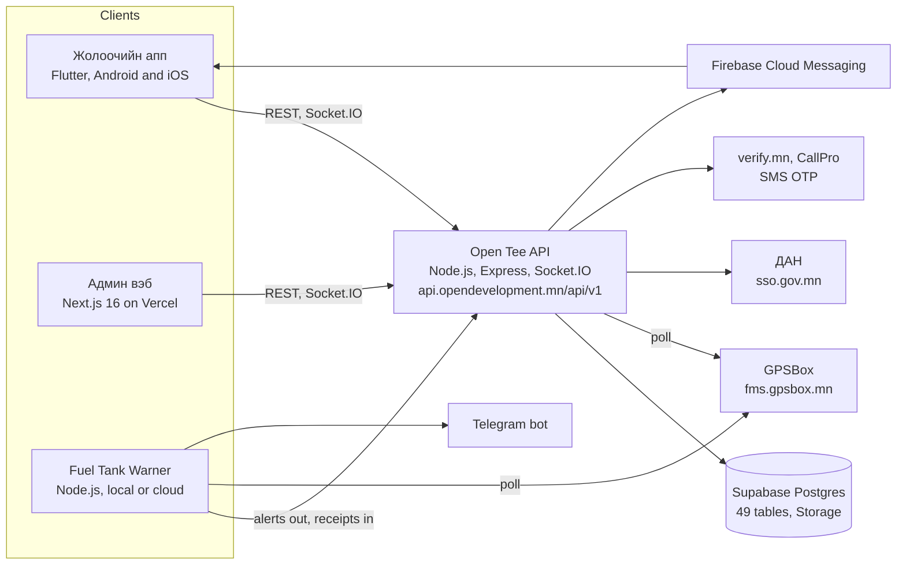
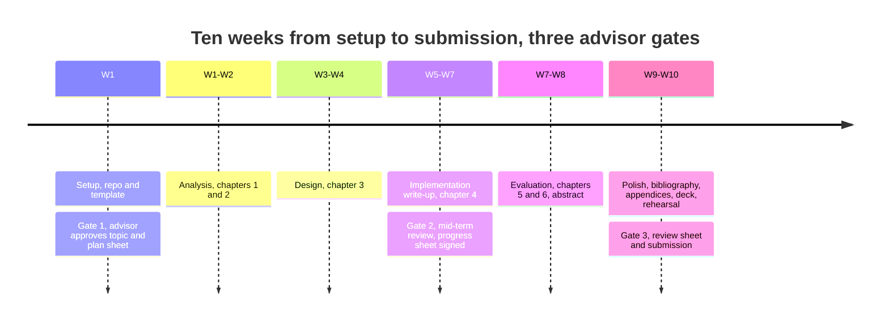

# Open Teever diploma thesis plan

## 1. Goal and deliverables

The goal is a complete MUST School of ICT bachelor diploma on **Open Teever**, the fleet, driver and fuel management system built at Open Development, written in Mongolian in the MUST LaTeX format and ready to defend. The subject is the whole system: the API, the admin web, the driver app and the Fuel Tank Warner. The example repository (SentimentAI) supplies only the format.

| # | Deliverable | Format | Built from | Done when |
| --- | --- | --- | --- | --- |
| 1 | Thesis (Дипломын ажил), 85–100 pages | XeLaTeX, `MUST-Thesis.cls`, single `main.tex` | the four Open Teever repos | builds with 0 errors and 0 undefined references; advisor approves |
| 2 | Formal sheets: title pages, ТӨГСӨЛТИЙН АЖЛЫН ТӨЛӨВЛӨГӨӨ, ТӨГСӨЛТИЙН АЖЛЫН ЯВЦ, ШҮҮМЖИЙН ХУУДАС, declaration, abstract | pages inside the thesis | the template's forms | real names, topic and dates filled in; signatures collected |
| 3 | Defence deck, 12–15 slides, plus a 10-minute demo script | pptx and a Markdown walkthrough | the thesis and the live system | rehearsed once end to end |
| 4 | Figures: about 10 diagrams and 25 screenshots | Mermaid to PNG; PNG | repos and the running apps | every figure referenced in the text, personal data blurred |
| 5 | Evaluation data and results | anonymised CSV and tables | production database export, test runs | the numbers quoted in the results chapter |
| 6 | Appendices: API list, database schema, configuration samples, run guide, source listings | thesis appendix | repos | matches the deployed version |
| 7 | Documentation vault and repository | this vault inside `Open-Teever-Diploma` | this plan, the system map, chapter notes | pushed; PDF builds in CI |

Done means deliverables 1 to 7 exist, the PDF passes the template checks, and the advisor has signed the plan and progress sheets.

## 2. Topic framing

Title, chosen by K on 2026-11-03: **Тээврийн парк, жолооч, түлшний хяналтын нэгдсэн мэдээллийн систем (Open Teever)** (candidate 1), an Information Systems thesis about the whole system with fuel-loss detection as its research core. The advisor may still edit the wording; candidates 2 and 3 stay here as fallbacks.

| # | Монгол нэр | English | Emphasis |
| --- | --- | --- | --- |
| 1 | Тээврийн парк, жолооч, түлшний хяналтын нэгдсэн мэдээллийн систем (Open Teever) | Integrated fleet, driver and fuel management information system (Open Teever) | whole system, analysis and design; **chosen** |
| 2 | GPS телеметрт суурилсан түлшний хяналт бүхий дотоод тээврийн удирдлагын систем | Internal transport management system with GPS-telemetry fuel control | whole system, fuel detection as the measured result |
| 3 | Олон байгууллагын тээврийн платформ: GPS, ДАН, SMS үйлчилгээний интеграци | Multi-tenant transport platform integrating GPS, DAN e-identity and SMS services | architecture and integration |

Suggested subtitle for title 1: *API, админ вэб, жолоочийн апп болон GPS мэдрэгчид суурилсан түлшний алдагдал илрүүлэх модулийн хөгжүүлэлт*.

**Research problem.** A Mongolian trucking company runs drivers, trucks, trips (рейс), papers and fuel through paper forms, Excel and the GPS provider's separate portal. Fuel losses are found late or never, refuel receipts cannot be checked against the tank, and dispatchers do not see trip state in real time. No integrated system ties the driver's actions to telemetry and back-office control. Open Development is the case company.

**Objectives**

1. Analyse the company's processes and requirements: dispatch, trip, refuel, documents, maintenance, reporting.
2. Design a multi-company architecture: API, admin web, driver app and telemetry service on one database.
3. Implement the system and integrate GPSBox telemetry, DAN e-identity, verify.mn and CallPro OTP, Supabase Postgres and Storage, and push notifications.
4. Implement and evaluate fuel-drain detection and refuel-receipt reconciliation from fuel-sensor telemetry.
5. Test the system, measure its effect on operations and document it.

**Research questions**

1. Which processes and requirements of a Mongolian trucking company must an internal transport management system cover?
2. What architecture lets several companies share one API and database safely, with real-time tracking?
3. How reliably can fuel drains be detected and refuel receipts verified from GPS fuel-sensor telemetry, and at what false-alarm rate?
4. What measurable effect does the system have on operations: time saved, litres flagged, adoption by drivers and staff?

**Novelty (шинэлэг тал)**

- Driver onboarding verified through the state e-identity service DAN (sso.gov.mn) inside a fleet app.
- Each refuel receipt is reconciled with the litres the fuel sensor actually saw enter the tank.
- Fuel-drain detection that trusts only settled readings and a physical burn ceiling, with a printable evidence pack per incident.
- Per-company data isolation in one Postgres database after a MongoDB migration, with one transaction per request.
- A Mongolian-language driver app with trip safety sign-off, handwritten receipt capture and a locked trip state.

**Scope.** In: the four repositories as deployed in 2026, the business processes they cover and their integrations. Out: the Facebook marketing automation kept in the warner repo, the SentimentAI example, accounting beyond fee orders, and GPS tracker hardware.

## 3. The system in one page

Open Teever (Дотоод тээврийн удирдлага) is one API behind three clients: the driver app, the staff admin web and the Fuel Tank Warner. Supabase Postgres is the single database and GPSBox telemetry is the main external feed. The first commit is from 2026-01-26; all four repositories were still active in late October 2026. Details: [[System map]].

| Component | Repository | Stack | Size on 2026-11-03 | Runs at |
| --- | --- | --- | --- | --- |
| Open Tee API | `opendev_server` | Node.js, Express, Socket.IO, pg + knex, Supabase Postgres | 122 commits, ~29,800 lines, 29 route groups, 182 endpoints, 49 tables, 30 test files | api.opendevelopment.mn on Vultr with PM2; a Vercel config is kept |
| Admin web | `opendev_admin` | Next.js 16.4, React 19, Radix UI, Tailwind, Leaflet, Recharts | 128 commits, ~29,200 lines, 42 pages | admin.opendevelopment.mn on Vercel |
| Driver app "Open Teever" 2.1.0+40 | `opendev_app` | Flutter, Riverpod, go_router, Dio, Firebase Messaging, Google Maps, Socket.IO | 117 commits, 192 Dart files (~42,800 lines with generated code), 10 test files | Android and iOS builds |
| Fuel Tank Warner | `OpendeGPS-fuel-notify` | Node.js 24, one dependency (`postgres`), browser dashboard; cloud variant on Vercel with Supabase pg_cron | 36 commits, ~18,800 lines, 11 self-test tools | a Windows PC at the company, or fuel.opendevelopment.mn |

**External services.** GPSBox (fms.gpsbox.mn) supplies positions, fuel-sensor voltage, ignition and odometer. DAN (sso.gov.mn) verifies a citizen's identity and vehicle data with consent. verify.mn and CallPro deliver login one-time codes. Supabase holds the database and private file storage served through signed URLs. Firebase Cloud Messaging pushes notifications to drivers, Telegram carries warner alerts, and Google Maps and OpenStreetMap draw the maps.

## 4. Chapter outline mapped to the repos

The thesis keeps the six-chapter MUST structure of the example. Implementation and results carry half the weight and draw on all four repositories; the target is 85–100 pages.

| Chapter | Content | Fed by | Pages |
| --- | --- | --- | --- |
| Front matter | title pages, ТӨЛӨВЛӨГӨӨ, ЯВЦ and ШҮҮМЖ sheets, declaration, Хураангуй, acknowledgments, abbreviations, contents and lists | template macros | 10 |
| 1 Оршил | background on Mongolian trucking and Open Development, problem, goal, objectives, research questions, hypothesis, significance, scope and limits, method overview, structure | this plan | 5–6 |
| 2 Онолын хэсэг | fleet management and telematics, GPS fuel-sensor principles (mV readings, calibration, settling), multi-tenant web architecture (REST, JWT, Socket.IO, Postgres transactions), Flutter app architecture, OAuth2 e-identity with DAN, SMS OTP, comparison with similar systems, technical challenges | literature, READMEs, `docs/` | 15–18 |
| 3 Арга зүй | business processes (dispatch, рейс, delivery, sign-off; refuel, receipt, GPS check), requirements and use cases per role, architecture and deployment topology, technology choice, data model (core ERD from the 49 tables), algorithms (fuel-drain detection, receipt reconciliation, scheduler lease), UML diagrams, test environment | `opendev_server` routes, controllers and migrations; warner `src/`; app `features/` | 22–25 |
| 4 Хэрэгжилт | project structure per repo; database and company isolation; API modules (auth and OTP, drivers, vehicles, tasks, fuel, reports, GPSBox poller, DAN, Socket.IO); admin web (42 pages); driver app (login, DAN, рейс flow, receipts, weigh slips, sign-off, push); Fuel Tank Warner (poller, meter, detector, evidence, Excel, API link, cloud variant); deployment and CI; testing (30 server, 10 Flutter, 11 warner self-tests) | all four repos | 22–25 |
| 5 Үр дүн | functions per role with screenshots; test results; fuel detection on real history (alerts by type, confirmed thefts against false alarms, litres, receipts with gaps); operational numbers (companies, vehicles, drivers, trips, users); limitations; discussion | database export, warner ledger, test runs | 10–12 |
| 6 Дүгнэлт | results against objectives, novelty, limitations, future work | | 3–4 |
| Ном зүй | at least 25 references: books, papers, standards, vendor documentation | | 2 |
| Хавсралт | configuration samples (names only), endpoint list for 29 route groups, database schema, run guide, selected source listings, company permission letter | repos | 8–12 |

The plan sheet (ТӨГСӨЛТИЙН АЖЛЫН ТӨЛӨВЛӨГӨӨ) keeps the five rows and weights of the template; the dates are filled once the deadline is known.

| № | Ажлын бүлэг | Эзлэх хувь | Covers |
| --- | --- | --- | --- |
| 1 | Удиртгал, асуудлын тодорхойлолт | 5 % | chapter 1 |
| 2 | Онолын хэсэг, хэрэглэгдэх технологи | 20 % | chapter 2 |
| 3 | Судалгааны арга зүй, системийн архитектур | 25 % | chapter 3 |
| 4 | Системийн хэрэгжилт ба туршилт | 35 % | chapter 4 and the test runs |
| 5 | Үр дүн, дүгнэлт, тайлангийн боловсруулалт | 15 % | chapters 5 and 6, formatting, deck |

## 5. Material inventory

Most of the evidence already exists in the repositories. The gaps are diagrams, clean screenshots, an anonymised data export and the literature.

**Already in the repos**

| Material | Where | Used in |
| --- | --- | --- |
| Operating docs: API environment, GPSBox, OTP, DAN and Socket.IO notes; warner algorithm, alert table, Excel ledger, API link | `opendev_server/README.md`, `OpendeGPS-fuel-notify/README.md`, `OPENTEE.md` | chapters 3 and 4, run guide appendix |
| MongoDB to Supabase migration plan with a decisions table | `opendev_server/docs/supabase-switch-plan.md` | chapter 3 technology choice, chapter 4 database |
| Key-rotation checklist after the 2026-10-08 incident | `opendev_server/docs/security/key-rotation.md` | chapter 5 lessons, generic wording, no values |
| Database schema: 21 migration files, 49 tables | `opendev_server/db/migrations/` | ERD, schema appendix |
| 29 route groups, 182 handlers, 33 services, 4 schedulers | `opendev_server/routes/`, `services/`, `server.js` | API tables in chapter 4, endpoint appendix |
| Automated tests: 30 server test files on Postgres, 10 Flutter test files, 11 warner self-tests, CI workflows | `tests/`, `test/`, `tools/`, `.github/workflows/` | chapter 4 testing, chapter 5 results |
| Fuel detection code with its thresholds | warner `src/detector.js`, `meter.js`, `motion.js`, `receipts.js`; server `services/fuelTelemetry.js` | chapter 3 algorithm, pseudo-code figures |
| Ten-step driver guide images and marketing cards | `facebook-app-posts/guide-v3/`, `facebook/cards/` | chapter 5 user manual figures |
| Example thesis: class, preamble, forms, deck, Mongolian demo walkthrough | `MAX-Diplom.sentimant.ai/thesis/`, `docs/ЗААВАР.md` | format only |
| The live system | admin.opendevelopment.mn, api.opendevelopment.mn, fuel.opendevelopment.mn | screenshots, real numbers |

**To produce**

| Item | How | Effort |
| --- | --- | --- |
| 10 diagrams: use case, two BPMN processes, architecture, deployment, core ERD, three sequence diagrams (рейс start, receipt check, DAN login), activity (fuel detection), state (рейс, alert) | Mermaid `.mmd` to PNG with the example's puppeteer config | 3 evenings |
| 25 screenshots: 12 admin pages, 8–10 app screens, 4–5 warner views and one evidence PDF | a test company and the driver test account; blur names, phones, plates | 2 evenings |
| Evaluation dataset: alerts by type, verdicts, litres, receipts with gaps over the recorded months | anonymised SQL export from Supabase and the warner ledger | 1 evening plus company sign-off on the numbers |
| Operational numbers: companies, vehicles, drivers, trips, receipts, users by role | SQL counts | 1 hour |
| User survey: dropped. K decided on 2026-11-03 not to run one; adoption is shown by usage counts instead (registered and verified drivers, staff by role, active users) | SQL counts, no personal data | included in the operational numbers |
| Literature: at least 25 references and a comparison of similar systems | search plus vendor documentation | 3 evenings |
| Glossary of Mongolian, English and Chinese terms (рейс, падаан, пүү and others) and the figure-label table in [[Figure list]]: figures are rendered with Mongolian labels and can be re-rendered in English or Chinese from that table (K, 2026-11-03) | from the UI strings and the admin web's EN and ZH dictionaries | 2 hours |

## 6. Work plan

About ten weeks of evenings and weekends take the thesis from an empty repository to submission. Three advisor gates fix the calendar once a deadline exists; until then the plan runs in week numbers, and every date in the thesis (plan sheet, progress sheet, defence) is a macro in one block of `thesis/main.tex`, so they change in one place (K, 2026-11-03: keep the dates changeable).

Implementation is the longest phase and the only one that needs the live system; evaluation overlaps its last week so the data export starts early.

| Phase | Weeks | Output | Thread |
| --- | --- | --- | --- |
| 0 Setup | W1 | new repository laid out as a vault, template skeleton that compiles, plan sheet filled, topic agreed with the advisor | this thread |
| 1 Analysis | W1–W2 | process maps, requirements, use cases, comparison table; chapters 1 and 2 drafted | Write chapters 1 and 2 |
| 2 Design | W3–W4 | architecture, deployment, core ERD, UML set, algorithm descriptions; chapter 3 | Write chapter 3 |
| 3 Implementation | W5–W7 | per-component write-up with code excerpts, screenshots and test results; chapter 4 | Write chapter 4 |
| 4 Evaluation | W7–W8 | anonymised data export, numbers, usage counts; chapters 5 and 6, abstract | Evaluate and write chapters 5 and 6 |
| 5 Polish | W9–W10 | bibliography, appendices, format checks, PDF build, deck, demo rehearsal | Finish, deck and defence |

Each thread ends with a pull request to this repository, and the progress sheet (ТӨГСӨЛТИЙН АЖЛЫН ЯВЦ) gets one signed row per closed phase.

## 7. Tooling and repository setup

Everything lives in [Asmodify/Open-Teever-Diploma](https://github.com/Asmodify/Open-Teever-Diploma), saved to the Claude project on 2026-11-03. The repository root is the Obsidian vault (decided 2026-11-03: K already opened it there, and notes can embed the figures in `thesis/Figures` directly); `vault/` is the notes folder inside it and `thesis/` builds the PDF. Obsidian's own `.obsidian/` folder stays on each device and is git-ignored. The notes are the source of truth for this plan.

| Path | Holds | Notes |
| --- | --- | --- |
| `vault/` | notes: 00 Home, 01 Plan, 02 System, 03 Chapters, 04 Figures, 05 Sources, 06 Meetings | Markdown with wikilinks; the repository root is opened as the vault in Obsidian |
| `vault/01 Plan/Thesis plan.md` | this plan | updated when decisions change |
| `vault/02 System/` | the system map from the code and seven sanitized notes distilled from the company's own vault | [[Эх сурвалжийн зураглал]] records what was left out and why |
| `vault/03 Chapters/` | one note per chapter with its outline, sources and status | drafting happens here before LaTeX |
| `thesis/main.tex`, `thesis/MUST-Thesis.cls` | the thesis in one file, as in the example | XeLaTeX; Times New Roman on Windows, TeX Gyre fallback on CI |
| `thesis/diagrams/*.mmd` to `thesis/Figures/*.png` | Mermaid sources and rendered figures | `render.sh` / `render.ps1` with the example's puppeteer config |
| `thesis/references.bib` | bibliography, biblatex with biber | cited from the text, at least 25 entries |
| `thesis/presentation/` | defence deck | built in the last phase |
| `.github/workflows/thesis.yml` | builds the PDF on every push and attaches it as an artifact | the check every chapter pull request must pass |

Working rules: one thread per chapter, each ending in a pull request into `main`; the final PDF is built on Windows with MiKTeX as the example describes, and CI confirms every push still compiles; no secrets, exports or personal data are ever committed.

## 8. Risks, permissions and sensitive data

Permission from Open Development to describe the system is granted (K, 2026-11-03). The remaining risks are data handling, time and scope.

| Risk or item | Handling |
| --- | --- |
| Secrets in history: the server repository was public for a while with an `.env`, an SSH key and a Firebase service account committed (rotated after 2026-10-08) | never paste configuration values; the appendix lists variable names only; the incident appears only as a generic security lesson |
| Personal data: drivers' names, phones, DAN identity data, receipt photos, plates, client names and prices | screenshots from the test company and the driver test account; blur or replace; evaluation tables aggregated; no raw exports in the repository |
| Published numbers | aggregate counts only and no personal data (K, 2026-11-03): how many people use the system (registered and verified drivers, staff by role), fleet size, alert counts and litres; the company is named with its permission; every count is confirmed with the company before it enters the thesis ([[Эх сурвалжийн зураглал]]) |
| GPS provider and government services | describe protocols and data fields at the level of their public documentation; no API keys, no screenshots of provider consoles |
| Written consent | collect a short signed letter from the company for the appendix ([[Permission letter template]]) even though verbal permission exists |
| Time: a full-time job beside the thesis | ten-week plan with gates; chapters split into threads; one short check-in a week |
| Scope: four repos, 49 tables, 42 admin pages | modules are described at feature level; depth goes to the fuel pipeline, the рейс flow and authentication |
| Template drift: department requirements may differ from the example | confirm with the advisor at gate 1; keep the class file untouched |
| Thin evaluation data: the warner keeps 61–90 days of history | export early; the Excel ledger and the `fuel_events` table keep refuels and drains for good |
| Fonts and builds differ between Windows MiKTeX and Linux CI | font fallback in the preamble; CI is the check, the final PDF is built on Windows |

## 9. Decisions needed from K

Answered by K on 2026-11-03; details in [[Decisions log]].

- [x] Advisor and department: the names stay as in the example (Магистр Б.Мөнхбуян, Мэдээллийн технологийн тэнхим) and may change; they are filled in `thesis/main.tex` and marked as unconfirmed.
- [x] Deadline: none yet; the plan stays in week numbers and every thesis date is a macro in one block of `main.tex`, so dates stay changeable.
- [x] Title: candidate 1.
- [x] Numbers: aggregate counts may be published, above all how many people use the system; no personal data. The company is named with its permission.
- [x] Vault: the repository root is the Obsidian vault (recommended and applied); `vault/` is the notes folder inside it.
- [x] User survey: no. Adoption is shown by usage counts.
- [x] Figure labels: Mongolian; an English and Chinese label table in [[Figure list]] lets any figure be re-rendered in those languages.

Still open for the advisor at gate 1: the final title wording and the department's template requirements.

## 10. Next step

The whole thesis is drafted (2026-11-03, PR_PLACEHOLDER) and builds to PDF in CI. What is left: (1) the company confirms the numbers in [[Numbers to confirm]]; (2) K captures the seven screenshots listed in [[Figure list]]; (3) the signed permission letter is scanned into `thesis/Figures/permission_letter.pdf`; (4) the advisor reads the draft (gate 1 and onwards: title wording, dates, department names); (5) the defence deck.
