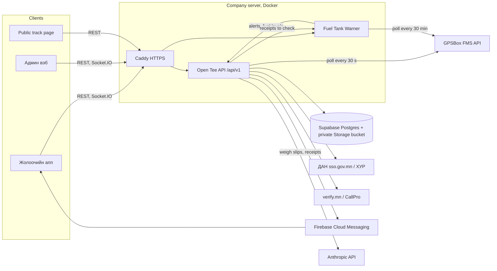

# System map — Open Teever (from the code)

Open Teever ("Дотоод тээврийн удирдлага") is Open Development's internal transport management system: one API, a staff admin web, a driver app and a fuel-monitoring program that watches the GPS provider. Four repositories under `Asmodify` on GitHub.

This note is the code-derived view. The operational view, distilled from the company's own notes, is in [[Системийн тойм]], [[API сервер ба өгөгдлийн сан]], [[Админ вэб]], [[Жолоочийн апп]], [[Түлшний хяналт ба GPS]] and [[Бизнес контекст ба шийдвэрийн түүх]]; what was left out of the public repository and why is in [[Эх сурвалжийн зураглал]].

## Components

| Component | Repository | Stack | Size (tracked files, lines) | Runs at |
| --- | --- | --- | --- | --- |
| Open Tee API | `opendev_server` | Node.js 20, Express 4, Socket.IO 4, pg + knex over Supabase Postgres 17, node-cron, multer, xlsx, AWS S3 SDK against Supabase Storage, Anthropic SDK; `process.env.TZ = Asia/Ulaanbaatar` | 230 files; 27,863 lines of JavaScript (29 route files with 182 handlers, 32 controllers, 33 services, 38 repositories, 7 middleware); 19 SQL migrations, 1,977 lines, 49 tables, 120 indexes, 26 triggers; 36 test files with 210 cases | `api.opendevelopment.mn`, Docker on the company's server behind Caddy |
| Admin web | `opendev_admin` | TypeScript 5.7, Next.js 16.4.3 App Router (all pages client-side), React 19, Tailwind v4, shadcn/ui (23 primitives), Radix, lucide, recharts, Leaflet + OpenStreetMap, socket.io-client, date-fns (mn), IBM Plex via next/font | 171 files; 29,102 lines of TS/TSX (118 .tsx, 25 .ts; `lib/types.ts` alone 1,230 lines); 42 pages; EN and ZH dictionaries of 3,189 lines each | `admin.opendevelopment.mn` on Vercel |
| Driver app "Open Teever" | `opendev_app` (Dart package `opendev`, 2.1.0+40) | Flutter ≥ 3.38, Riverpod 2, go_router 14 (64 routes), dio 5, freezed (14 models), flutter_secure_storage, socket_io_client, geolocator, maps (Google Maps in code until 2026-10-31, OpenStreetMap from 2026-11-02), firebase_messaging, signature, image_picker; IBM Plex Sans bundled | 414 files; 43,121 lines of Dart (178 hand-written lib files, 36,640 lines; 19 test files, 4,549 lines, 212 test declarations, 392 executed with language and font-scale variants) | Android and iOS stores |
| Fuel Tank Warner | `OpendeGPS-fuel-notify` (package `fuel-tank-warner`) | Node.js 24 ESM with zero runtime dependencies for the local program (`node:sqlite`, hand-written `.xlsx` writer, vanilla-JS dashboard with SSE); `postgres` only for the cloud variant; Leaflet + OpenStreetMap; PowerShell toasts on Windows | 112 files; ≈ 20,500 lines (15,691 lines of JavaScript in 34 files, of which `public/app.js` 3,138, `src/engine.js` 2,089, `src/detector.js` 1,447); 11 self-test tools | Docker next to the API behind Caddy (`fuel.opendevelopment.mn`); originally an office Windows PC; a Vercel + Supabase cloud variant is work in progress |

### History and authorship

| Repository | Commits | Period | Authorship (by commit) |
| --- | --- | --- | --- |
| `opendev_server` | 122 | 2026-01-26 → 2026-10-27 | contractor phase 43 (Jan–Oct 6), in-house 43, AI-assisted (Claude Code sessions) 36; 87 of the 122 commits are from October 2026 |
| `opendev_admin` | 128 | 2026-10-09 → 2026-11-03 | in-house 50, AI-assisted 78; earlier generator-made history was not kept; 37 pull requests |
| `opendev_app` | 117 | 2026-03-16 → 2026-10-31 | contractor phase 44 (Mar–Oct 6, versions 1.0.0 → 1.0.13), in-house 34, AI-assisted 39; 74 commits in October 2026 |
| `OpendeGPS-fuel-notify` | 36 | 2026-09-24 → 2026-10-27 | in-house 13, AI-assisted 23 |

The thesis must state this split plainly: a previous contractor company built the first API, app and admin web (January to early October 2026); from 2026-10-06 the company took the code over and K developed it in-house with AI assistance. Chapter 3 describes that way of working; see [[Thesis plan]].

## Architecture

- Every API request runs in one Postgres transaction with the caller's company set as `app.company_id` (`SET LOCAL`), which is the tenant boundary. RLS is enabled on every table with no policies: only the service role connects, so isolation is enforced by the application.
- Live tracking goes over the Socket.IO namespace `/tracking`; the admin tracking page polls REST every 30 s as a fallback and the per-driver page polls GPSBox-backed data every 120 s, never while the tab is hidden. The public page `admin.opendevelopment.mn/track/<code>` needs no login and is limited to 30 requests a minute per IP.
- Background jobs (GPSBox poller, registry sync at 02:00 and every 6 h, monthly reports at 07:00, retention at 03:30) run inside the API process and coordinate through a Postgres lease table, so several replicas are safe. Provider "call limit" answers pause polling for 10 minutes, growing to an hour.
- The warner pushes every alert type to the API with a shared key, hashes the alert key as the event id so no IMEI leaves the program, sends litres only ("no money leaves this program"), and never overwrites a verdict given in the admin web. The API pulls the drivers' refuel receipts back for checking.

## API (`opendev_server`)

**Route groups** (`/api/v1/...`): auth, user, company, driver, driver-requests, driver-blacklist, vehicle, vehicle-request, handover-act, contract, fee-order, shift, tracking, maintenance-request, dashboard, report, notification, task, fuel, document, announcement, client, audit, dan, registry, rig, component, public, integrations.

**Services worth a section each:** `gpsBoxPoller`, `gpsBoxService`, `gpsDeviceSync`, `fuelTelemetry`, `fuelReceiptReader`, `weighSlipReader`, `tripHistoryService`, `liveLocation`, `registryScheduler` + `registryService` (ДАН / ХУР vehicle data), `reportScheduler` + `reports` (monthly reports), `retentionScheduler` (daily cleanup, off unless enabled), `schedulerLock`, `notificationDispatch`, `integrationHealth`, `taskPadaan`, `driverPapers`, `contractTemplate`, `operatingRules`, `organizationSettings`, `userAuth` + `authSessions`.

**Engineering decisions recorded in the code and docs**
- MongoDB to Postgres in eight slices (2026-10-08) while keeping the Mongo JSON shape (`_id`, `companyId`, camelCase) through a mapper layer, so the admin web and the app needed no change; old ObjectIds mapped to uuid5 under a fixed namespace so pre-cutover tokens kept working.
- Schema conventions: uuid keys plus `legacy_id`, `ON DELETE RESTRICT` by default, enums as text + CHECK, nested objects flattened, `set_updated_at` trigger everywhere, TTL indexes replaced by expiry columns plus an opt-in cleanup job.
- Single-instance background jobs through a lease table and advisory locks instead of an external queue.
- Fuel detection moved out of the API into the Fuel Tank Warner on 2026-10-14; the in-API detector had written 227 alerts in production and was deleted (migration 013). The API only ingests, de-duplicates and notifies.
- Files moved from a public bucket owned by the contractor to a private Supabase bucket; the database stores `storage://` keys and responses are rewritten to short-lived signed URLs.
- Two second factors by role: CallPro OTP for drivers, verify.mn mobile-originated SMS for console roles; HMAC-hashed codes, lockouts, `token_version` revocation.
- Accountant read-only through a central allow-list; tenant delete suspends instead of removing; permanent purge is a preview-then-confirm flow that requires typing the word УСТГАХ.
- Road vehicles may come only from ХУР or the official Excel lists; the dolly is the only hand-registered type; plate normalisation handles Cyrillic and Latin look-alikes.
- LLM document reading (weigh slips, fuel receipts) with strict JSON schemas of at most 16 nullable fields and server-side consistency checks (duplicate slip, plate mismatch, weight and litre tolerances) rather than trust in the model.
- New app flows ship behind feature gates switched off until the apps support them.
- Tests run on PGlite (WASM Postgres) with the real migrations instead of mocks.

**Quality and security.** 210 node:test cases read like acceptance criteria ("scheduler lease: one holder at a time", "public track: limited to 30 a minute per IP"). Rate limits: login 10 per 15 min, OTP 3 per 5 min, public track 30 per min. bcrypt passwords, HMAC OTP hashes, account lockout, idle timeout, append-only registry logs enforced by triggers, masked IMEI and register numbers in exports, CSV formula-injection guard, 15 s statement timeout. No CI, linter or coverage tool is tracked. The repository was public for a time with secret files committed; they were removed on 2026-10-08 and a names-only rotation checklist was written. Never quote values or old commits in the thesis.

**Known limitations.** No SMTP, so monthly reports are in-app only. ДАН vehicle services are disabled and registry sync needs citizen consent. Retention is off by default. `001_initial.sql` is still headed "FIRST DRAFT"; migrations 005 and 006 are missing from the sequence. Long provider calls hold a database connection for the whole request. Socket.IO CORS is `*`. Weigh-slip reading supports three slip layouts. Some test fixtures (real fleet spreadsheets) are not tracked, so those tests cannot run from a clean clone.

## Admin web (`opendev_admin`)

**Pages (42).** Dashboard; dispatch; tasks (list, new, detail); requests; tracking (live map, per driver, places, trips); drivers (list, detail, photos, requests, papers, fees, blacklist); owner-operators; fuel; vehicles (list, detail, GPS, import, requests); repairs (components, acts); inspections (handover acts only since 2026-10-29); reports; notifications; announcements; organization and organizations; settings (users, audit); login and forgot-password; print views (component act, driver papers); public track page.

**Engineering decisions**
- The server is the authorization boundary; the UI mirrors the server role groups in a route-access table and shows 403 otherwise.
- Mongolian is the single source language; EN and ZH are applied by a runtime DOM translator (MutationObserver) with 2,407 exact and 194 pattern strings per language and a coverage script.
- Only the truck counts as a vehicle (it carries driver, tank and GPS); trailers and dollies are set members counted separately.
- OpenStreetMap/Leaflet because the live admin has no Google Maps key (2026-10-12).
- Fuel-monitor SSO passes the token by `postMessage` with origin checks, never in the URL (2026-10-19).
- Map places are one shared resource used identically by admin, fuel monitor and driver app.
- A fuel receipt requires a photo; receipts are matched to GPS refuels within 2 min with 24 h grace.
- Flat visual system (no shadows, coal and hi-vis yellow tokens, IBM Plex) shared with driver app 2.0 and the fuel monitor.
- Status vocabulary centralised so raw API values are never displayed; features that depend on newer server migrations degrade to "not live".

**Quality and security.** No automated tests and no CI; ESLint and strict TypeScript, but production builds ignore type errors. Bearer token in `localStorage` (an XSS exposure, cookie migration planned), security headers and a partial CSP, Next.js upgraded to 16.4.3 on 2026-11-02 for a critical advisory. Code review happened through 37 pull requests.

**Known limitations.** Partial CSP (tile, API and socket origins not yet listed); `/fuel` loads at most 1,000 receipts and 500 × 20 GPS events; planned-route geometry is unavailable because shift direction is text-only; ХУР background sync is off for lack of citizen consent; weigh-slip OCR supports three layouts; the driver's last trip is derived from the latest 200 tasks.

## Driver app (`opendev_app`)

**Features** (`lib/features/`): auth (welcome, login, OTP, verify.mn sign-up, register, password reset), onboarding (7 wizard steps), dan (identity verification in the system browser), documents, driver_profile, company, papers (contract, fee orders), vehicle (requests, assigned truck, handover acts, truck change), shift (start and end, live GPS), jobs (рейс: step machine, checklist rules, locked mode, camera and location capture, weigh slip, proof of delivery, sign-off), fuel (refuel receipts, fuel level, sensor card), maintenance (damage report), map_places, history, notifications, announcements, settings, profile, terms, app_update, private_carrier, home ("Өнөөдөр" dashboard). Versions: 1.0.13+13 (2026-10-06, end of the contractor phase) → 1.0.14 ship-ready (2026-10-21) → 2.0.0 (2026-10-26) → 2.0.2 (2026-10-27…29) → 2.0.3 → 2.1.0+40 (2026-10-29); the 2.1.41+41 store build.

**Engineering decisions**
- Mongolian is the source language in code; `.tr` looks up 1,279-key EN and ZH tables and falls back to Mongolian; values sent to the server stay Mongolian.
- Feature-first layering with plain-Dart domain rules (trip rules, distances, error classification) so they are unit-tested without widgets.
- Lenient JSON parsing and explicit compatibility with older servers ("a missing field is empty, never an error"; 404 without a code means "not live yet").
- The server decides the рейс lock; the phone caches the last answer so an app reopened offline stays locked; position posted every 60 s; the router enforces the allowed paths.
- Automatic photo and receipt checks only mark, never block; only a missing photo, an unstarted рейс or an empty signature blocks sending.
- Drivers pick from fixed lists (5 routes = GPS groups, 5 fuel stations, receipt types, truck classes) and type numbers on an on-screen pad.
- Flat coal + hi-vis design system: radii 8, 56–64 px buttons, 12 px text floor; IBM Plex bundled because runtime font downloads failed offline.
- Screens verified on a 360 × 740 phone in three languages and at 130 % font scale by widget tests.
- ДАН opens in the OS browser surface with a custom-scheme callback; the backend session is the source of truth.
- Tokens in encrypted storage; the HTTP logger redacts password, token, OTP, phone, e-mail and identifier; session-ending server codes force sign-out; every request carries the build number so the server can refuse old builds (426).
- Refuels, fuel readings and damage reports are filed on the truck being driven, never on the newly assigned one; the return act completes on the mechanic's admin-web signature.

**Known limitations.** iOS push is not configured. GPS tracking runs only while the app is in the foreground (no background-location permission). The fuel level page shows the current level only, by the owner's rule of 2026-10-29. Some sent-back fixes are kept only on the phone when the API does not record them. One store build (2.1.41+41) stayed on the logo screen because the git-ignored `.env` was missing from the build; fixed on 2026-10-31 by loading it optionally. README and desktop scaffolds are Flutter boilerplate.

## Fuel Tank Warner (`OpendeGPS-fuel-notify`)

**Modules** (`src/`): `api` (GPSBox client with rate-limit detection), `poller` (objects, messages, events, prune loops, backfill, backlog hold, call budget), `detector` (pure streaming per-vehicle detector), `engine` (records, settings, alerts, 5 h hold, offline logic, receipts, evidence, report), `meter` (check against the meter's own readings, burn ceiling, probe fault), `motion`, `receipts`, `refuelplaces`, `ledger` + `xlsx` + `alertsxlsx` + `fleetstatus` (three Excel workbooks from a dependency-free OOXML writer), `opentee` (the API link), `notify` (Windows toasts), `sse` + `routes` + `server`, `mn` (English alert texts translated to Mongolian at display time), `cloud/` (Vercel handler, tick under a lease, in-memory store, Postgres). Dashboard views: Fleet, Map, Alerts, Evidence ("Нотлох баримт", one A4 page per incident), Report, Settings.

**Engineering decisions**
- Zero npm dependencies so that "nothing needs to be installed except Node.js".
- The detector is pure and deterministic (no I/O, timers or clock); alert times derive from sample timestamps and the backend de-duplicates on `imei:type:fromT`, so a replay after restart creates no duplicate alerts.
- Fuel levels are trusted only from settled readings while standing still, because the analog reading sloshes by thousands of mV while driving; "engine running" needs alternator-level voltage, not the ignition flag alone.
- Thresholds are kept in mV with litre equivalents from piecewise tank tables, extended above the table top because clamping under-counted fills.
- Tuned on 7 days of real fleet data with a replay tool; defaults tightened on 2026-10-13 (parked 300 → 250 mV, trip 600 → 450 mV, headroom 1.5 → 1.3×).
- A fuel drop is held 5 h before it becomes a critical alert; a level that comes back is closed as a false alarm.
- Evidence rests on the meter's own raw readings and a hard burn ceiling (1.3 L/km, 50 L/h on the road, 6 L/h idling) "so a driver cannot argue that fuel beyond the ceiling went into the engine"; incidents the meter does not confirm are shown as "not evidence" rather than hidden.
- The database is the record and the Excel ledger is rebuilt in full every time, written atomically; drains and refuels are never deleted, enforced by SQLite triggers.
- Full-history polling mode was chosen after measuring that gap mode missed half the drains; the call budget per interval is documented (128 vehicles: 30 min ≈ 3,000 calls a day, 5 min ≈ 20,000).
- Receipt matching assigns big receipts first; differences under 20 L or 5 % are normal; a receipt waits 6 h for data.

**Quality.** No test runner or CI; manual self-tests with throw-away databases and fake APIs: 29 end-to-end checks, 50 meter cases, 27 evidence checks, 37 API-link checks, 87 workbook checks, an SSO test and a chunked-versus-continuous detector equivalence test. The documented integration test delivered 761 real fuel events (605 refuels, 54 drains, 81 low fuel, 21 sensor faults) to a local API. Security: HMAC-signed HttpOnly cookies, login throttling, Host-header guard against DNS rebinding, origin checks on mutating calls, path-traversal guard, a secret scanner that treats IMEIs and plates as secrets.

**Known limitations.** The README still documents Telegram, which the code removed. The cloud variant has no live stream, no receipts check and keeps samples 72 h only. History older than the 31-day backfill window is never fetched; no verdict across a data hole over 2 h where the vehicle may have moved. Litres exist only for trucks with a tank table; tables are 10–15 % off near the top. Trackers in hourly parked mode detect parked thefts late. The repository also carries an unrelated marketing side project (rendered card images) that makes up most of its size.

## Database (49 tables in the 2026-10-27 code; 54 by the 2026-11-02 audit)

| Domain | Tables |
| --- | --- |
| Organisation and users | companies, organization_settings, users, user_sessions, user_otps, login_events, audit_logs |
| Drivers | driver_profiles, driver_blacklist, dan_verification_sessions, documents, contracts, fee_rates, fee_orders, fee_order_signoffs, handover_acts, shifts |
| Clients and work | clients, client_addresses, tasks, task_signoffs, task_weigh_slips, trip_histories |
| Vehicles | vehicles, vehicle_requests, vehicle_components, vehicle_component_layouts, vehicle_component_acts, rigs, maintenance_requests, athub_certificates, registry_request_logs, registry_snapshots |
| GPS and fuel | gps_devices, gps_device_approximate_vehicles, location_pings, fuel_samples, fuel_events, fuel_entries |
| Communication and reports | notifications, announcements, announcement_recipients, announcement_reads, report_schedules, report_schedule_recipients |
| Integrations and operations | integration_checklists, integration_checklist_items, provider_call_logs, scheduler_locks |

Later migrations known from the company notes (022–031): push tokens (025), map places (026), app update policy (027), рейс parity (028), weigh-slip register (029), terms acceptances (030); see [[API сервер ба өгөгдлийн сан]]. The ER diagram comes from `db/schema-meta.json` (723 columns, 109 foreign keys).

## Cross-cutting themes for the thesis

- **Multi-tenancy and access control:** per-request tenant transaction, 7–8 roles with Mongolian labels, a role × route matrix in the admin web, read-only accountant, staff-only fuel monitor.
- **Trust in external data:** GPS readings trusted only when settled; LLM output checked by rules; government services (ДАН, ХУР) wrapped in consent and outage handling.
- **Honest degradation:** every client tolerates an older server ("not live yet"), feature gates ship off, forced update as a last resort.
- **Localisation:** Mongolian source strings, EN and ZH tables in all three products, tests that both tables cover the same keys.
- **One design system across web, app and monitor:** flat, coal and hi-vis yellow, IBM Plex.
- **Security after a hand-over:** committed secrets in history, rotation checklist, later audit (2026-11-02) and fixes.

## What the code does not contain

No screenshots, diagrams or test reports are tracked in any repository, so every figure must be produced: diagrams from this map and the Mongolian notes, screenshots from the deployed products with test data ([[Figure list]]). Production counts (vehicles, drivers, trips, receipts, alerts by verdict, litres) come from the company notes and must be confirmed with the company ([[Эх сурвалжийн зураглал]]).

## Handling rules for this material

Code paths, table and function names are fine to cite. Do not reproduce: values from any environment file or old commit, hostnames other than `*.opendevelopment.mn`, the contractor's name or its staff, client company names, IMEIs, plates, phone numbers, e-mail addresses, store or Firebase identifiers, or any real driver record. Test fixtures with invented names are still not to be shown as if they were real data.
