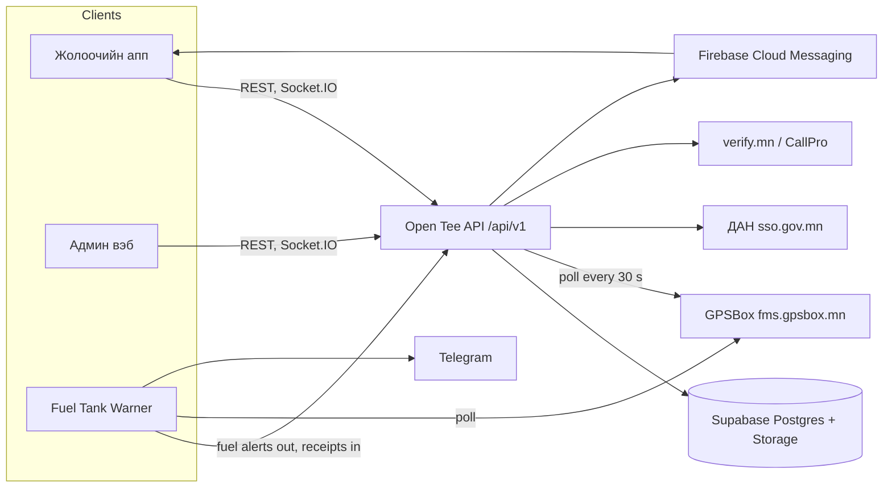

# System map — Open Teever

Open Teever (Дотоод тээврийн удирдлага) is Open Development's internal transport management system: one API, a staff admin web, a driver app and a fuel-monitoring program that watches the GPS provider. Four repositories, all under `Asmodify` on GitHub.

## Components

| Component | Repository | Stack | Size on 2026-11-03 | Runs at |
| --- | --- | --- | --- | --- |
| Open Tee API | `opendev_server` | Node.js, Express, Socket.IO, pg + knex, Supabase Postgres; `process.env.TZ = Asia/Ulaanbaatar` | 122 commits (2026-01-26 to 2026-10-27), ~29,800 lines, 29 route files, 182 handlers, 32 controllers, 33 services, 21 migrations, 49 tables, 30 test files | api.opendevelopment.mn on a Vultr server with PM2; `vercel.json` and a Dockerfile are kept |
| Admin web | `opendev_admin` | Next.js 16.4.3, React 19, Radix UI, Tailwind, Leaflet, Recharts, socket.io-client, Vercel Analytics | 128 commits (2026-10-09 to 2026-11-03), ~29,200 lines, 42 pages | admin.opendevelopment.mn on Vercel |
| Driver app "Open Teever" | `opendev_app` (package `opendev`, 2.1.0+40) | Flutter, Riverpod, go_router, Dio, freezed, Firebase Messaging, Google Maps, geolocator, socket_io_client, signature pad; languages mn, en, zh | 117 commits (2026-03-16 to 2026-10-31), 192 Dart files, 10 test files | Android and iOS |
| Fuel Tank Warner | `OpendeGPS-fuel-notify` (package `fuel-tank-warner`) | Node.js 24 ESM, one dependency `postgres`, SSE dashboard in `public/`; cloud variant `src/cloud/` on Vercel (region hnd1) with Supabase and pg_cron every minute | 36 commits (2026-09-24 to 2026-10-27), ~18,800 lines, 11 self-test tools in `tools/` | a Windows PC at the company (`start.bat`), or fuel.opendevelopment.mn |

## Architecture

- Clients call `https://api.opendevelopment.mn/api/v1/*`; every request runs in one Postgres transaction with the caller's company set as `app.company_id` (per-company isolation).
- Live tracking goes over a Socket.IO namespace; the admin tracking page also polls the REST API every 30 seconds as a fallback. A public tracking page `admin.opendevelopment.mn/track/<code>` needs no login.
- The warner pushes refuels, suspected drains, low fuel and sensor faults to the API every minute (`FUEL_WARNER_KEY` / `OPENTEE_KEY`), and pulls the drivers' refuel receipts back to check them against the tank; the verdicts show on the admin pages "GPS түлшний хяналт" and "Түлш цэнэглэлт" and in the driver app.
- Only one API process polls GPSBox at a time (a Postgres lease in `scheduler_locks`), so PM2 clusters are safe; provider "call limit" answers pause polling for 10 minutes, growing to an hour.

## API route groups (`/api/v1/...`)

auth, user, company, driver, driver-requests, driver-blacklist, vehicle, vehicle-request, handover-act, contract, fee-order, shift, tracking, maintenance-request, dashboard, report, notification, task, fuel, document, announcement, client, audit, dan, registry, rig, component, public, integrations.

Services worth a section each: `gpsBoxPoller`, `gpsBoxService`, `gpsDeviceSync`, `fuelTelemetry`, `fuelReceiptReader`, `weighSlipReader`, `tripHistoryService`, `liveLocation`, `registryScheduler` + `registryService` (DAN / ХУР vehicle data), `reportScheduler` + `reports` (monthly reports), `retentionScheduler` (daily cleanup, off unless `CLEANUP_ENABLED=true`), `schedulerLock`, `notificationDispatch`, `integrationHealth`, `taskPadaan`, `driverPapers`, `contractTemplate`, `operatingRules`, `organizationSettings`, `userAuth` + `authSessions`.

## Database (49 tables, migrations 001–021)

| Domain | Tables |
| --- | --- |
| Organisation and users | companies, organization_settings, users, user_sessions, user_otps, login_events, audit_logs |
| Drivers | driver_profiles, driver_blacklist, dan_verification_sessions, documents, contracts, fee_rates, fee_orders, fee_order_signoffs, handover_acts, shifts |
| Clients and work | clients, client_addresses, tasks, task_signoffs, task_weigh_slips, trip_histories |
| Vehicles | vehicles, vehicle_requests, vehicle_components, vehicle_component_layouts, vehicle_component_acts, rigs, maintenance_requests, athub_certificates, registry_request_logs, registry_snapshots |
| GPS and fuel | gps_devices, gps_device_approximate_vehicles, location_pings, fuel_samples, fuel_events, fuel_entries |
| Communication and reports | notifications, announcements, announcement_recipients, announcement_reads, report_schedules, report_schedule_recipients |
| Integrations and operations | integration_checklists, integration_checklist_items, provider_call_logs, scheduler_locks |

Migration milestones: `001_initial` (the MongoDB to Postgres move), `007` vehicle components, `008` HR role, `009` dolly, `010` driver blacklist, `011` task tracking, `012` fuel warner link, `015` weigh slips, `019` task padaan, `020` task sign-off and handwritten receipts, `021` driver contracts and fee orders.

## Admin web (42 pages)

Dashboard; dispatch; drivers (list, detail, photos, blacklist, fees, papers, requests); fuel; inspections; notifications; organization and organizations; owner-operators; repairs (acts, components); reports; requests; settings (users, audit); tasks (list, new, detail); tracking (live map, per driver, places, trips); vehicles (list, detail, GPS, import, requests); login and forgot-password; print views (component act, driver papers); public track page.

## Driver app (features in `lib/features/`)

auth (welcome, login, OTP, SMS verify, register, forgot and new password), dan (identity verification page and card), driver_profile, company, documents, fuel (fuel level page, refuel page with receipt photo, vehicle fuel card), jobs (jobs list, job detail and instruction, open trip, рейс flow, live рейс, рейс end, trip photo and send, proof of delivery, weigh slip, safety rules, task sign-off), history, home dashboard with today view, announcements, app update, push notifications. Terms of use at first sign-in and driver safety instructions before each рейс were added in October 2026 (app 2.1.0+40).

## Fuel Tank Warner (modules in `src/`)

`poller` (GPSBox history and live data), `meter` (settled fuel readings, calibration mV to litres), `motion` (driving, idling, stops), `detector` (drains, refuels, sensor faults, power cuts, offline, overspeed, long idle, after-hours), `receipts` (receipt matching), `ledger` + `xlsx` + `alertsxlsx` (the Excel fuel ledger), `fleetstatus`, `refuelplaces`, `notify` (Windows toasts, Telegram), `opentee` (the API link), `sse` + `routes` + `server` (dashboard API), `cloud/` (Vercel function, Postgres, cron tick). Dashboard views: Fleet, Map, Alerts, Evidence (Нотлох баримт, one A4 page per incident), Report, Settings. Detection rules worth quoting: levels are read only from settled readings (10 minutes after a stop), a fall under 2.5 % of the level is ignored, the burn ceiling is 1.3 L/km or 50 L/h on the road and 6 L/h idling, a dip that recovers within 3 hours is downgraded, and three agreeing readings over two hours are needed for parked trackers.

## Security and operations

JWT sessions with OTP confirmation for superadmin and accountant logins (verify.mn or CallPro), 15-minute lockout after 5 failed passwords, organisation-level idle timeout, signed URLs for private files, audit log, Content-Security-Policy subset in the admin web (Next.js 16.4.3). The server repository was public for a time with secrets committed; `docs/security/key-rotation.md` (2026-10-08) lists what was rotated. Never quote values from it.

## Numbers to confirm from production (not in the repos)

Companies, vehicles, drivers, users by role, trips per month, receipts, fuel alerts by type and verdict, litres flagged, GPS devices with fuel sensors.
