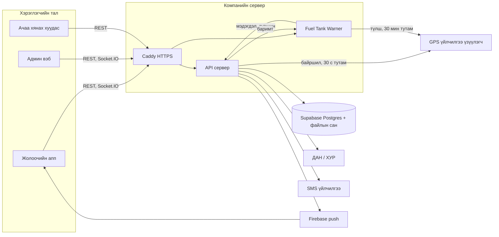

# Системийн тойм

> Компанийн дотоод "Open Tee систем" vault-ын долоон тэмдэглэлийг дипломд зориулж нэгтгэсэн, сервер хаяг, данс, нууц, үнийн дүн, хувь хүний мэдээллийг хассан хувилбар. Кодоос гаргасан нарийвчилсан зураглал: [[System map]]. Эх тэмдэглэлүүд K-ийн компьютер дээр үлдэнэ ([[Эх сурвалжийн зураглал]]).

## Нэр ба зорилго
- Системийн нэр **Open Teever** (эхний нэр "Open Tee", 2026-10-15-аас "Open Teever"). Opendevelopment ХХК-ийн нүүрс тээврийн дотоод удирдлагын систем.
- Зорилго: тээврийн парк, жолооч, рейс, түлшний алдагдлыг нэг дор бүртгэж, хяналтын ажлыг хөнгөвчлөх. Мөнгөн тооцоо хийдэггүй: литр, тоо, огноо л явна (компанийн дүрэм, [[Бизнес контекст ба шийдвэрийн түүх]]).
- Хэрэглэгч: оффисын ажилтнууд (диспетчер, механик, нягтлан, хүний нөөц, захирал) админ вэбээр; жолооч нар аппаар; ачаа эзэмшигч нэвтрэлтгүй хянах холбоосоор.

## Дөрвөн бүрэлдэхүүн
| Бүрэлдэхүүн | Юу хийдэг | Технологи | Хаана ажилладаг | Тэмдэглэл |
|---|---|---|---|---|
| API сервер | Бүх өгөгдөл, эрх, бизнес дүрэм | Node.js, Express, Socket.IO, Postgres | Компанийн виртуал сервер (Tokyo бүс), Docker + Caddy | [[API сервер ба өгөгдлийн сан]] |
| Админ вэб | Оффисын ажлын хэрэгсэл | Next.js, shadcn/ui, Leaflet | Vercel | [[Админ вэб]] |
| Жолоочийн апп | Бүртгэл, рейс, түлш, баримт | Flutter (Android, iOS) | Google Play, App Store | [[Жолоочийн апп]] |
| Fuel Tank Warner | GPS-ийн түлшний мэдрэгчээс хулгай, цэнэглэлт илрүүлэх | Node.js, SQLite | Нэг сервер дээр API-тай хамт | [[Түлшний хяналт ба GPS]] |

Нэмэлт: нийтийн танилцуулга хуудас `www.opendevelopment.mn` (Vercel), өгөгдлийн сан Supabase Postgres (Tokyo бүс), домэйн дотоодын бүртгэгч компанид.

## Архитектур

Тайлбар:
- API ба warner нэг сервер дээр, гаднаас зөвхөн Caddy-ийн HTTPS порт нээлттэй. Warner-ийн самбарт нууц үгээр эсвэл админ вэбээс нэг товчоор (SSO) ордог.
- Админ вэб, танилцуулга хуудас Vercel дээр `main` салбараас өөрөө build хийгддэг; API, warner гараар deploy хийгддэг ([[API сервер ба өгөгдлийн сан]]).
- Файл (жолоочийн бичиг баримт, зураг, баримт) хаалттай bucket-д хадгалагдаж, 1 цагийн хугацаатай гарын үсэгтэй холбоосоор уншигдана.
- Газрын зураг бүгд OpenStreetMap: админ вэб 2026-10-12-оос, апп 2026-11-02-оос (өмнө Google Maps).

### Төлөвлөсөн, хараахан хийгээгүй
Дотоод тэмдэглэлд дараах зүйлс "хийх" гэж бүртгэлтэй (2026-11-03-ны байдлаар хийгдээгүй):
- Ажлын (worker) контейнер: тайлан, retention, ХУР sync зэрэг хуваарьт ажлыг API процессоос салгах.
- Өөрийн файлын сан (MinIO) эсвэл Supabase Storage-ийн нөөц хуулбар.
- Uptime хяналт (uptime-kuma) ба анхааруулга.
- API-д өөрийн өгөгдлийн сангийн role + RLS бодлого (одоо service role-оор холбогддог).
- Админ вэбийн token-ыг `localStorage`-аас HttpOnly cookie руу шилжүүлэх.
Эдгээр нь дипломын "Цаашдын хөгжүүлэлт" хэсэгт шууд орно ([[Ch6 Дүгнэлт]]).

## Түүх (товч)
| Үе | Юу болсон |
|---|---|
| 2026-01 … 2026-09 | Өмнөх гүйцэтгэгч компани Express + MongoDB (serverless платформ дээр) API, Flutter апп, үүсгүүрээр хийсэн админ вэб хөгжүүлсэн |
| 2026-09-24 | Fuel Tank Warner-ийн эхний хувилбар (оффисын компьютер дээр) |
| 2026-10-06 … 10-08 | Код, данс, нууцыг компани өөртөө шилжүүлж авсан; 2026-10-07 MongoDB → Supabase Postgres шийдвэр; 2026-10-08 Postgres хувилбар live |
| 2026-10-09 … 10-14 | Админ вэб шинэ repo-д, OpenStreetMap, засвар ба бүрдэл, хар жагсаалт, ачаа хянах холбоос, warner ↔ API холбоос; хуучин MongoDB толь устгагдсан (10-14) |
| 2026-10-15 … 10-21 | Нэр "Open Teever", warner сервер дээр, пүүний баримт уншигч, SSO, 15 хоногийн сесс, `main` = live дүрэм (10-19) |
| 2026-10-22 … 10-31 | Апп 2.0 → 2.1 (шинэ дизайн, жолооч рейс нээх, түгжигдсэн горим, гэрээ, акт, push, газрын нэрс, заавал шинэчлэх, үйлчилгээний нөхцөл), store-д гаргах |
| 2026-11-02 … 11-03 | Аюулгүй байдлын шалгалт ба засвар, түлшний хяналт зөвхөн ажилтанд, кодын граф |

## Live (бодит цагийн) функцууд
| Функц | Урсгал | Давтамж |
|---|---|---|
| Машины байршил | Апп → API (Socket.IO) → админ вэбийн газрын зураг; API GPS үйлчилгээнээс мөн татна | Апп 60 с тутам (түгжигдсэн горимд), API 30 с тутам; админ вэб Socket.IO тасарвал REST-ээр 30 с тутам |
| Хүсэлтийн мэдэгдэл | API → админ вэб (Socket.IO) | Шууд |
| Түлшний түвшин | Warner → API → апп (жолоочийн машины карт) | 5 мин тутам |
| Түлшний мэдэгдэл (14 төрөл) | Warner → API → админ вэб, мэдэгдлийн хуудас | Шалгалт бүрт (30 мин) |
| Баримт ↔ GPS тулгалт | Апп → API → warner → API (дүгнэлт) | Баримт ирэх бүрт, өгөгдөл 6 цаг хүртэл хүлээнэ |
| Зарлал push | Админ вэб → API → Firebase → апп | Шууд |
| Ачаа хянах холбоос | Нэвтрэлтгүй хуудас → API | 8 тэмдэгтийн код, IP тутамд 30 хүсэлт/мин |

## Кодын граф
2026-11-02-нд graphify хэрэгслээр дөрвөн repo-г зөвхөн AST түвшинд уншсан:

| Үзүүлэлт | Утга |
|---|---|
| Зангилаа | 9,305 |
| Холбоос | 23,698 |
| Кластер | 259 |
| Import цикл | алга |
| Серверийн төв функцууд | `db()`, `isUuid()`, `resolveCompanyScope()` |
| Админ вэбийн төв функцууд | `apiFetch()`, `Button()`, `cn()` |
| Уншсан migration | 001–030 |

Repo тус бүрийн хэмжээ, тест, түүх, зохиогчийн хуваарилалт: [[System map]].

## Гадаад үйлчилгээ
| Үйлчилгээ | Юунд | Тэмдэглэл |
|---|---|---|
| Виртуал сервер (Tokyo бүс) | API, warner, Caddy | Автомат нөөц хуулбартай |
| Supabase (Pro) | Postgres, файлын сан | Tokyo бүс |
| Vercel (Pro) | Админ вэб, танилцуулга хуудас | `main`-аас автомат build |
| GPS үйлчилгээ үзүүлэгч (GPSBox) | 128 төхөөрөмж (Teltonika FMB920), байршил, түлшний мэдрэгч | API 30 с, warner 30 мин тутам; дуудлагын хязгаартай |
| ХУР / XYP | Машины бүртгэл, иргэний мэдээлэл | Иргэний зөвшөөрөл шаардлагатай тул автомат sync унтраалттай |
| ДАН (sso.gov.mn) | Жолоочийн биеийн байцаалтын баталгаажуулалт | WS100101, WS100407, WS100417 үйлчилгээ; 2026-10-21–28 улсын талаас ажиллаагүй; 2026-10-15 гэхэд 23 жолооч баталгаажсан |
| SMS (CallPro, verify.mn) | Жолоочийн OTP, оффисын нэвтрэлтийн 2 дахь хүчин зүйл | verify.mn: хэрэглэгч өөрөө код бичиж явуулна |
| OpenStreetMap | Бүх газрын зураг | Түлхүүргүй, зардалгүй |
| Firebase (компанийн өөрийн төсөл) | Push мэдэгдэл | 2026-10-29-өөс өөрийн төсөл |
| Google Play, App Store | Аппын түгээлт | Компанийн өөрийн данс руу шилжүүлэх шийдвэртэй |
| Anthropic API | Пүүний баримт, түлшний баримтын зураг уншуулах | Баримт тутамд маш бага зардал; серверийн дүрмээр давхар шалгана |
| Домэйн бүртгэгч | DNS | Дотоодын компани |
| GitHub | 4 repo | Нийтийн байсан repo-г 2026-10-27 цэвэрлэсэн |

### Зардлын бүлгүүд (дүнгүй)
Сар бүрийн зардал: сервер, Supabase, Vercel, GPS үйлчилгээ (төхөөрөмж тутамд), SMS (мессеж тутамд), store-ийн данс (жилийн), LLM уншигч (баримт тутамд), домэйн. Дипломд дүн оруулахгүй; "ямар зардал байдаг" хүснэгт ба бүтэц (тогтмол / хэрэглээнээс хамаарах) л орно.

## Баримт бичгийн нөөц (зураг, видео)
| Материал | Тоо | Дипломд |
|---|---|---|
| Жолоочийн бүртгэлийн заавар (текст) | 1 | Хавсралт |
| Бүртгэлийн видео | 3 | Дэлгэцийн зураг авах эх |
| Аппын дэлгэцийн зураг | 53 | S-зургууд ([[Figure list]]) |
| Админ вэбийн видео (21 алхам, 4:44, туршилтын өгөгдөл) | 1 | Админ дэлгэцийн зураг авах эх |
| Ажилтны сургалтын слайд | 23 | Бүлэг 3, 5 |
| Портфолио, танилцуулга хуудас | 1 | Оршил |

Бүх дэлгэцийн зургийг туршилтын өгөгдлөөр авна; бодит жолооч, улсын дугаар харагдах зураг ашиглахгүй.

## Дипломд ашиглах
| Бүлэг | Энэ тэмдэглэлээс юу орох |
|---|---|
| Бүлэг 1 Оршил | Системийн зорилго, хэрэглэгч, дөрвөн бүрэлдэхүүн, түүхийн товч |
| Бүлэг 2 Онолын хэсэг | Клиент-сервер архитектур, бодит цагийн холбоо, гадаад үйлчилгээний интеграц |
| Бүлэг 4 Хэрэгжилт | Архитектурын диаграм, байршуулалтын хүснэгт, live функцын хүснэгт, кодын графын үзүүлэлт |
| Бүлэг 5 Үр дүн | Хэмжээ, давтамж, гадаад үйлчилгээний найдвартай байдал (ДАН-ы зогсолт) |
| Бүлэг 6 Дүгнэлт | Төлөвлөсөн ажлууд |

Зурах зүйл: D1 архитектур, D2 байршуулалт, D3 компонентын холбоо, D12 хуваарьт ажил ([[Figure list]]).
