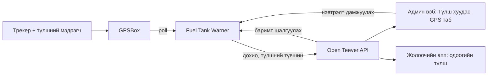

# Түлшний хяналт ба GPS (Fuel Tank Warner)

> Компанийн дотоод vault-ын таван тэмдэглэлийг дипломд зориулж нэгтгэсэн, улсын дугаар, трекерийн дугаар, нууц үг, дотоод хаягийг хассан хувилбар ([[Эх сурвалжийн зураглал]]).

## Тойм
- Самбар: `https://fuel.opendevelopment.mn` (нууц үгээр, эсвэл админ вэбээс шууд). Repo `OpendeGPS-fuel-notify`, `main` = live (2026-10-19-өөс).
- Node.js, API сервертэй нэг виртуал сервер дээр тусдаа Docker контейнер, Caddy-гаар дамжина. Өөрийн SQLite сан (`fuel.db`); API-тай холбогдох түлхүүр хоёр талын `.env`-д.
- GPS үйлчилгээ үзүүлэгч (GPSBox, 128 төхөөрөмж, FMB920 төрлийн трекер) -ээс байршил ба түлшний мэдрэгчийн түвшинг татна. Зөвхөн литр, мөнгөгүй.
- Түүх: эхлээд оффисын компьютер дээр ажилладаг байсан; 2026-10-15-нд сервер дээрх хувилбар live болж, 2026-10-19-нд `main` = live болсон. 2026-11-02-ны аюулгүй байдлын засвараар нууц үггүй бол асахгүй.

## Код (`src/`)
| Модуль | Юу хийдэг |
|---|---|
| `poller` | GPS үйлчилгээнээс байршил, мэдрэгчийн түвшин татах |
| `detector`, `engine` | Цэнэглэлт ба бууралт илрүүлэх, дүгнэлт (verdict) |
| `receipts` | Аппаас ирсэн түлшний баримтыг мэдрэгчийн цэнэглэлттэй тулгах |
| `meter` | Нотлох баримт: хэмжигчийн заалтын график, A4 pack / PDF |
| `fleetstatus` | GPS ба мэдрэгч ажиллаж буй эсэх (флотын байдал) |
| `opentee` | Open Teever API руу дохио, түлшний түвшин илгээх, ажилтны эрх шалгах |
| `notify`, `alertsxlsx`, `xlsx` | Мэдэгдэл, Excel ledger ба тайлан |
| `server/routes` | Самбарын вэб хуудас ба API |

## Open Teever-тэй холбоос

- 2026-10-15: цэнэглэлт, бууралт, бага түлш, мэдрэгчийн гэмтэл API руу (`fuel_events`); аппаас болон админы "Баримт нэмэх"-ээс орсон баримт warner руу очиж, хэдэн литр саванд орсныг шалгаад үр дүнг буцаана (`fuel_entries.gps_check_*`).
- 2026-10-20: бүх 14 төрлийн дохио API руу: түлш, GPS тасарсан/холбогдсон, трекерийн тэжээл, хурд хэтрүүлэх, ажлын бус цаг, удаан сул ажиллах, баримт зөрөх. Шинэ дохио админ, тээврийн зохицуулагчид мэдэгдэл болж очно; машины GPS табд "GPS түлшний дохио" жагсаалт. Асахад татсан хуучин дохио мэдэгдэл үүсгэхгүй (SQL 016).
- 2026-10-21: мэдрэгчийн харсан цэнэглэлт бүр админы "Түлш цэнэглэлт" хуудсанд "GPS" мөр болж гарна (цаг, машин, танкинд орсон литр, өмнө → дараа, байршил); баримттай нь холбогдоно; баримтгүй бол 1 хоногийн дараа "Баримтгүй" (улаан). Шүүлтүүр: баримт ба GPS / зөвхөн баримт / зөвхөн GPS / баримтгүй GPS. CSV-д хоёулаа орно.
- 2026-10-29: warner 5 минут тутам машин бүрийн түлшний түвшин, мэдрэгч ажиллаж буй эсэх, итгэлтэй түвшинг API руу илгээнэ; API аппад өгнө. Шалтгаан: API-ийн өөрийн GPSBox түлшний талбарууд 2026-09-29-өөс зогссон байсан.
- Газрын нэрс (2026-10-29): серверийн `map_places` хүснэгтийн газрууд самбарын зураг дээр гарна; GPS цэнэглэлт газрын радиус дотор бол "Байршил"-ын оронд газрын нэр.

## Нэвтрэлт ба эрх
- Админ вэбийн "GPS түлшний хяналт" цэс нэвтрэлтийг шууд дамжуулна (хаягт биш, `postMessage`-ээр); warner API-аар шалгаад 15 хоногийн session өгнө. Нууц үгээр нэвтрэх хэвээр; буруу нууц үг зөвхөн тухайн хүнийг түгжинэ (`TRUST_PROXY=1`).
- Дүрэм (2026-11-02, нэг газар `services/fuelMonitorAccess.js`): идэвхтэй бүртгэлтэй, эрх нь компанийн админ, тээврийн зохицуулагч, нягтлан (зөвхөн харна) эсвэл инженер хянагч, бас эзэмшигч компанид харьяалагддаг хүн л орно; superadmin бол имэйл нь компанийн домэйнд. HR, жолооч, бусад байгууллага, гадны superadmin орохгүй. Админ вэб цэсийг зөвхөн сервер "тийм" гэсэн хүнд харуулна. Хаасан цоорхой 3: цэс бусад байгууллагад харагддаг байсан; хаанаас ч superadmin ордог байсан; ажлаас гарсан хүн 15 хоног нэвтэрсэн хэвээр үлддэг байсан.
- 2026-11-03: нэвтэрсэн хүн бүрийг 5 минут тутам серверээс дахин асууна; идэвхгүй болсон, эрх солигдсон, компани солигдсон бол шууд гаргана. Superadmin бүх байгууллагын түлшний хяналтыг харсаар байна (зориуд).
- Хандах хүн (2026-11-02): эзэмшигч компанийн 9 ажилтан (админ 2, тээврийн зохицуулагч 4, нягтлан 3) ба нэг superadmin.

## Илрүүлэх дүрэм ба нотлох баримт
### Түлшний нотлох баримтын дүрэм (2026-10-15, тогтсон)
1. График дээр зөвхөн жинхэнэ түлш хэмжигчийн заалт; дундаж зарцуулалт зэрэг нэмэлт шугамгүй.
2. Өсөлт бол цэнэглэлт, хэзээ ч хулгай биш.
3. Хүний "хуурамч дохио" гэсэн тэмдэглэл үргэлж давамгайлна.
4. Хөдөлгүүр шатаасан байж болох бууралт хулгай биш; замд гарсан маш том бууралт хулгай.
5. Нэг машины нэг цаг нэг л удаа тоологдоно.

### Дүгнэлтийн логик
- Бууралт бүрт verdict: `road` (замд шатаасан), `burnt` (зогсож шатаасан), `flicker` (мэдрэгчийн чичиргээ), батлагдсан бууралт. Хөдөлж байхад уншсан түвшинг тооцно, хуурамч дохиог хэзээ ч тоолохгүй, давхцлыг нэг удаа (2026-10-19-ний хувилбар; шатаалтын дээд хязгаарыг хассан).
- Нотлох баримт: зөвхөн хэмжигчээр батлагдсан бууралтад A4 pack / PDF, Excel ledger. Эхний pack-ийг эзэмшигч буцааж, дахин хийлгэсэн (2026-10-15).
- Мэдэгдэж буй алдаа: цэнэглэлтийн detector заримдаа дүүргэлтийн дундаас хэмжиж 100+ л дутуу тоолдог (нэг чиглэлийн машинууд дээр); засвар тэр чиглэлд туршигдаагүй.
- Тайлангийн засвар (2026-10-21): трекер км тоолуураа 0 болгоод буцахад үүссэн >1000 км үсрэлтийг зай зөвшөөрвөл л тооцно (нэг машинд 30 хоногт 18,977 км гэж гарч байсан, үнэндээ ~2,965 км); мэдрэгч нэг заалт дээр гацсан машин 100 км-ээс илүү явсан ч 100 км-т 15 л-ээс бага гарвал "шалгах" гэж харуулаад нийт дүнд тооцохгүй; 30/60 хоногийн тайлан 12–20 секунд байсныг хурдасгаж 10 минут кэшлэнэ, 90 секундийн хүлээлт; 24 цагийн зарцуулалт өмнөх өдрийн сүүлийн зогсоолоос эхэлдэг (30 хоногт тэнцэнэ).

### Үр дүнгийн тоо
| Хэмжүүр | Утга | Огноо |
|---|---|---|
| Бууралт: илэрсэн → хэмжигчээр батлагдсан | 59 → 19 (683 л) | 2026-10-15 |
| Баримт: нийт → мэдрэгчээр батлагдсан | 115 → 20 (6,107 л) | 2026-10-15 |
| Нэг incident-ийг шинэ логикоор дахин тоолсон | 9 бууралт / 911 л (хуучин 16 / 560 л) | 2026-10-19 |
| Мэдрэгч гэмтэлтэй гэж тэмдэглэсэн машин | 2 | 2026-10-15 |
| Хуучин GPSBox түлшний alert устгасан | 227 | migration 013 |

## Шалгалт ба тулгалт (гар аргаар хийсэн шинжилгээ)
### Түлшний баримт vs GPS (нэг чиглэл, 2026-10)
- Шалгаж болох 20,195 л баримтаас 20,069 л саванд орсон: 126 л дутуу (0.6%).
- Мэдрэгчийн шугамын хазайлт: 590 л-ийн хүснэгт ~2.5% өндөр, 480 л-ийнх ~7.5% бага уншдаг (калибровкийн алдаа).
- Жинхэнэ дутагдал 3 машин, бүгд нэг ШТС, нэг цагийн дотор: −89, −75, −73 л.
- Мэдрэгч 9-р сараас ажиллахгүй 4 машин, мэдрэгчгүй 4, GPS-д байхгүй 1.

### Зогсоолын бүртгэл vs GPS
- Зогсоолын байрлалыг машинууд бөөгнөрсөн цэгээс (радиус 300 м) тогтоож, 03:00-д тэнд байвал "нэг шөнө" гэж тоолсон.
- Бүртгэлийн 29 мөрөөс 22 үнэн. Зөрүү: нэг машин ерөөсөө ирээгүй (5 шөнө, ~196 км зайд), нэг нь сүүлийн 3 шөнө байгаагүй, давхар бичилт, +1 өдөр, GPS-гүй машин. Олон машин тооцсоноос удаан зогссон.

### GPS ажиллагааны KPI (13 машин, 2026-09)
- Хэвийн 3, тасалдалтай ч хэвийн 4, асуудалтай 5: 2 долоо хоног дохиогүй атлаа 375 км явсан; тэжээл 10 удаа тасарсан; тэжээл бараг өдөр бүр тасардаг; 5 хоног тэжээлгүй.
- Явж байхад тасалдал нэг замын нэг хэсэгт олон машинд давтагдсан: сүлжээгүй бүс байх магадлалтай (үр дүнгийн бүлэгт хязгаарлалт болгон бичих).

### Анхаарах машинууд (2026-10-27/28)
- Админд зориулсан жагсаалт (Excel, 5 хуудас): трекергүй, мэдрэгчгүй, GPS дуугүй, үзлэг дууссан машин.
- 152 зүтгүүрээс анхаарах 134, яаралтай 53; трекер холбогдоогүй 34; GPS 3+ хоног дуугүй 12; трекертэй ч мэдрэгчгүй 62; мэдрэгч гэмтэлтэй 2; мэдрэгчтэй ч 30 хоногт цэнэглэлт илрээгүй 8; түлш алдагдсан байж болзошгүй хэд хэд.
- GPS үйлчилгээ үзүүлэгчид илгээх ажлын жагсаалт: 66 машин (55 мэдрэгч шинээр, 9 шалгах, 2 засах, 14 трекер суурилуулах/засах). Нэг чиглэлд явдаг 60 мэдрэгчгүй машиныг байршлаар (GPS, утасны байршил, хуучин бичлэг) тогтоосон.
- Анхаар: засварын хүсэлт, эд ангийн акт системд тэр үед хоосон байсан тул засварын мэдээлэл зөвхөн үзлэгийн огнооноос гарсан.

## Түлш авах чиглэл (журам, 2026-10-21)
- Уурхай → гаалийн талбай → боомт чиглэлд нэг рейст түлшийг 2 цэгт авна: уурхай дээр ачсаны дараа эхний ШТС-аас 550 л, замын дунд хоёр дахь ШТС-аас 350 л; нийт 900 л (500-аас 550 болж өөрчлөгдсөн).
- Түлш авах бүрт жолооч баримтын зургийг аппаар илгээж ШТС-ийн нэрийг сонгоно; литр баримттай таарах ёстой, саванд орсныг мэдрэгчээр шалгана. Жолооч нарт A4 постер.

## Хяналтын дүрэм (бизнесийн тогтсон дүрэм)
1. Хүчинтэй бичиг баримтгүй бол жолоодохгүй: гэрээ, үнэмлэхний ангилал, гэрчилгээ, даатгал байхгүй бол хуваарилалт хаагдана; ДАН баталгаажуулалтгүй жолоочид машин хуваарилахгүй (`DAN_REQUIRED`).
2. Механик машиныг батална: хүлээлгэн өгөхийн өмнө үзэж зөвшөөрнө, жолооч аппаар хүлээн авна; буцааж өгөхөд мөн адил.
3. Түлш цэнэглэх бүрт баримт (дүнгүй, литр); баримт GPS мэдрэгчтэй таарах ёстой.
4. Засвар: жолооч гэмтлийг илгээнэ → механик төрөл, эд анги тодорхойлно → тээврийн зохицуулагч бүртгэнэ; үнэ бүртгэхгүй.
5. Түлшний хулгай: шинээр юм хийхгүй, Fuel Tank Warner-ийн мэдээллийг байгаагаар нь авна.
6. Рейс: зөвхөн тээврийн зохицуулагч үүсгэж хуваарилна; жолооч хүсэлт л илгээнэ. (2026-10-27-оос жолооч рейсээ өөрөө нээж, зохицуулагч батлах болсон: [[Жолоочийн апп]].)

## Харагдац
- 2026-10-19: бүлэг сонгох жагсаалтад машины тоо, улсын дугаараар хайх хажуугийн самбар, бүлэг ба төлөвөөр шүүх; хар цэс, шар идэвхтэй, IBM Plex / Plex Mono (дугаар хавтан шиг хүрээтэй), бүтэн дэлгэцийн зураг, сүүдэр ба градиентгүй.
- 2026-10-27: апп 2.0 ба админ вэбтэй нэг загвар (өнгө, булан 8/6/4, цагаан хаалганы тэмдэг, "Админ вэб" холбоос, Тайланд "Нийт" мөр). Сайт одоогоор зөвхөн Монгол.

## Дипломд ашиглах
| Бүлэг | Юу орох |
|---|---|
| Бүлэг 2 | Телематик, түлшний мэдрэгчийн дохио боловсруулалт, дүрэмд суурилсан илрүүлэлт, нотлох баримтын зарчим |
| Бүлэг 3 | Илрүүлэх алгоритм (verdict-ууд), баримт–мэдрэгч тулгалтын арга (1% хүлцэл), зогсоол/амралтыг GPS-ээр тогтоох арга, KPI тодорхойлолт |
| Бүлэг 4 | Warner ↔ API холбоос (дохио, түлшний түвшин, баримт шалгалт), эрхийн нэг цэгийн дүрэм, самбарын бүтэц |
| Бүлэг 5 | 59 → 19 бууралт, 115 → 20 баримт, 0.6% зөрүү, мэдрэгчийн хазайлт, KPI, анхаарах машины тоо, хаасан цоорхой 3 |

Зурах зүйл: activity диаграм түлш илрүүлэлт (D10), дохионы төлөвийн диаграм (D12), sequence баримт шалгалт (D8), түлшний хэмжигчийн графикийн жишээ (туршилтын машин, дугааргүй), тулгалтын хүснэгт.
